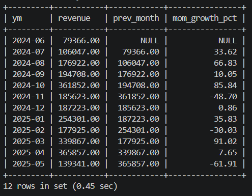
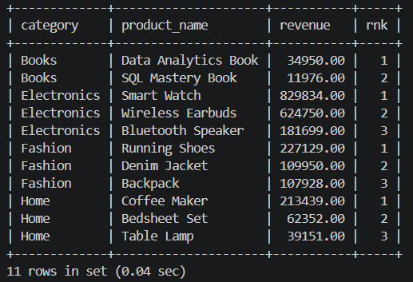
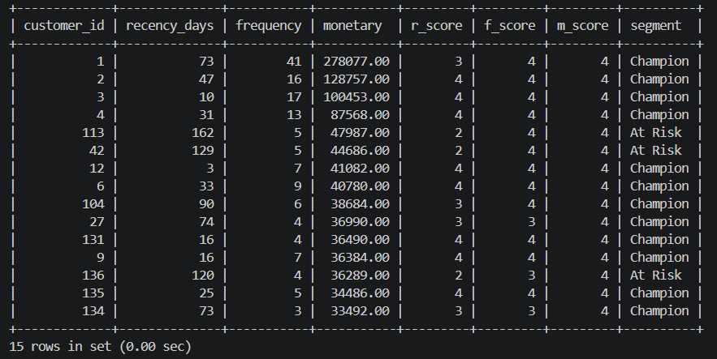
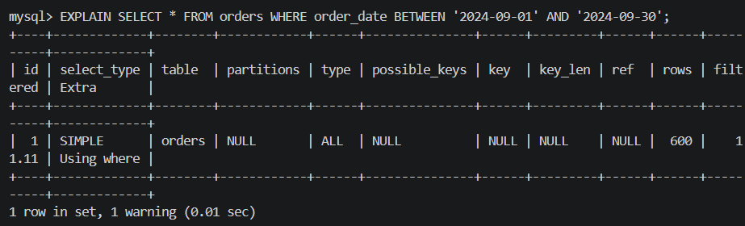
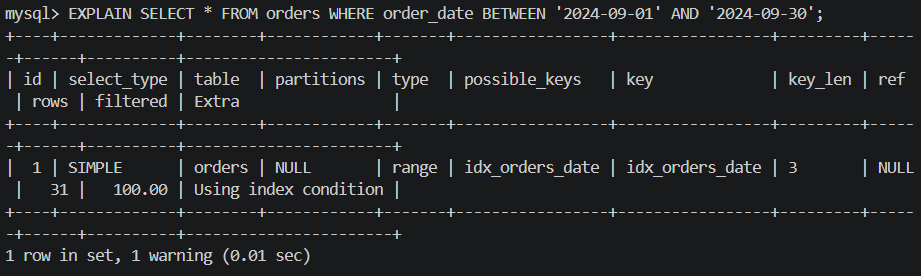

# E-commerce Sales Analysis (SQL)

An end-to-end SQL project on a relational e-commerce database: schema design, data generation, and 14 business-focused analysis queries covering revenue, customer behaviour, cohort retention and RFM segmentation.

**Tech:** MySQL 8 | **Concepts:** JOINs, CTEs, window functions, subqueries, views, stored procedures, indexing, EXPLAIN

## Schema

`customers` -> `orders` -> `order_items` <- `products`, and `orders` -> `payments`

| Table | Purpose |
|---|---|
| customers | Customer profile, city, signup date |
| products | Catalogue with category and price |
| orders | Order header with status (Delivered / Shipped / Cancelled / Returned) |
| order_items | Line items per order |
| payments | Payment method and amount per order |

## Project structure

| File | Description |
|---|---|
| `schema.sql` | Creates the database, tables, constraints and indexes |
| `data.sql` | Generates 150 customers, 12 products, 600 orders and related rows (realistic, skewed distributions) |
| `queries.sql` | 14 business questions plus a view, a stored procedure and an optimization demo |

## How to run

Open the MySQL client from the project folder, then run:

```sql
source schema.sql
source data.sql
source queries.sql
```

## Business questions answered

1. Total revenue, delivered orders and average order value
2. Order status split (cancellation and return rate)
3. Revenue by city
4. Customers who never ordered
5. Payment method share
6. Monthly revenue with month-over-month growth (`LAG`)
7. Running total revenue (`SUM() OVER`)
8. Top 3 products per category (`RANK` + `PARTITION BY`)
9. Top 10 customers by lifetime spend (`DENSE_RANK`)
10. Days between consecutive orders (`LAG`)
11. Busiest day of the week
12. New vs repeat customers
13. Cohort retention analysis
14. RFM customer segmentation (`NTILE`)

## Optimization

Used `EXPLAIN` to compare a date-range query before and after adding `idx_orders_date`, moving from a full table scan to an index range scan.

## Key skills demonstrated

- Relational schema design with primary keys, foreign keys and constraints
- Multi-table JOINs and aggregation
- CTEs and window functions (`LAG`, `RANK`, `DENSE_RANK`, `NTILE`, `FIRST_VALUE`)
- Customer analytics: retention cohorts and RFM
- Views, stored procedures and indexing

## Author

Subayogesh R | [LinkedIn](www.linkedin.com/in/suba-yogesh)

## Sample results




**Query optimization: before (full scan) vs after (index)**


